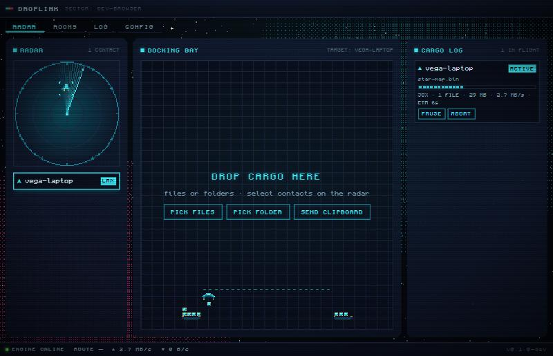

# DropLink

**Peer-to-peer file transfer with a sci-fi pixel console.** Send files, folders and text straight from one device to another, over the local network or across the internet through WebRTC. No server ever stores, sees or relays your files.



- **Find devices automatically** on the same Wi-Fi: they appear as ships on the radar.
- **Send anything**: files, whole folders (structure kept), or the clipboard, to one device or several at once.
- **Check who you're talking to**: both screens show the same 4 pixel glyphs; if they match, nobody is in between.
- **Cross networks** with a room code (or a QR code, or a `droplink://join/CODE` link).
- **Never start over**: dropped links reconnect and resume from the last byte received.
- **Small and quiet**: one Go engine under a 64 MiB memory cap, files streamed in 64 KiB chunks, animations that stop when you look away.

## Contents
- [How it works](#how-it-works)
- [Quick start](#quick-start)
- [Using DropLink](#using-droplink)
- [Security](#security)
- [Going across networks](#going-across-networks)
- [Installing and updates](#installing-and-updates)
- [Making a release](#making-a-release)
- [Configuration](#configuration)
- [Memory and speed](#memory-and-speed)
- [Project layout](#project-layout)
- [Development](#development)
- [Known limits](#known-limits)
- [Team](#team)

## How it works

```
┌──────────────────────────── DropLink desktop app ────────────────────────────┐
│  Tauri 2 shell (Rust)            Pixel UI (plain JS, in the system WebView)  │
│  window · tray · notifications   radar · docking bay · cargo log · pages     │
│  pickers · clipboard · links            │ HTTP + server-sent events          │
│        │ starts / stops                 │ 127.0.0.1, per-run token           │
│        ▼                                ▼                                     │
│  Go sidecar engine: transfer manager · streaming engine · settings · API     │
│        │                                                                      │
│        ├── LAN: UDP beacons (discovery) + encrypted TCP (X25519, ChaCha20)    │
│        └── WebRTC: pion DataChannels, set up through a signaling room         │
└──────────────────────────────────────────────────────────────────────────────┘
                                          │ only offers/answers/ICE candidates
                                          ▼
                              droplink-signal hub (optional, stores nothing)
```

- The **shell** (`desktop/`) is a small Tauri 2 app using the system WebView, not a bundled browser. It starts the sidecar, hands its port and token to the UI, and stops it on quit; the sidecar also exits by itself if the shell dies.
- The **sidecar** (`cmd/droplink-sidecar`, `internal/`) does all networking and file work. It listens on loopback only and wants a fresh random token on every call.
- The **UI** (`web/`) is plain HTML, CSS and ES modules: no framework, no bundler, no npm runtime dependencies.

The full design, wire formats and threading model are in [docs/ARCHITECTURE.md](docs/ARCHITECTURE.md); the sidecar API is in [docs/API.md](docs/API.md).

## Quick start

### Requirements
| Tool | Version | For |
|---|---|---|
| Go | 1.26+ | sidecar, hub, tests |
| Rust | stable (MSVC toolchain on Windows) | the desktop shell |
| Node.js | 20+ | Tauri CLI, UI tests |
| [Task](https://taskfile.dev) | 3 | the commands below |

```
go install github.com/go-task/task/v3/cmd/task@latest
go install honnef.co/go/tools/cmd/staticcheck@latest   # for task check
```
Windows also needs the WebView2 runtime (part of Windows 11) and the Visual Studio C++ build tools; Linux needs the usual Tauri packages (`libwebkit2gtk-4.1`, `libgtk-3`).

### Run it
```
task dev      # builds the sidecar and opens the desktop app with hot reload
task web      # just the sidecar + UI in a browser: http://127.0.0.1:7878
task installer   # Windows: the release app + the pixel-art installer, in dist/
task build       # Linux / macOS: deb, AppImage, dmg
```

To try it on one machine, start two sidecars with their own data folders and open both in a browser:
```
go run ./cmd/droplink-sidecar -web-dir web -addr 127.0.0.1:7878 -name nova -data-dir ./tmp/a
go run ./cmd/droplink-sidecar -web-dir web -addr 127.0.0.1:7879 -name vega -data-dir ./tmp/b
```
They find each other on the radar within two seconds. In a browser, file paths are typed into PICK FILES (browsers hide real paths); the desktop app uses native pickers and drag-and-drop instead.

## Using DropLink

**Send.** Pick one or more ships on the RADAR (click or Enter), drop files or folders on the DOCKING BAY (or use PICK FILES / PICK FOLDER / SEND CLIPBOARD), then LAUNCH. Each target gets its own transfer; at most two run at a time.

**Receive.** An offer pops up with who is sending what and **4 glyphs**. The sender's cargo log shows 4 glyphs too: if they match, accept. Tick *trust this device* to skip the question next time (when auto-accept is on). Files land in your download folder; an unfinished file is kept as `name.droplink-part` and the next transfer of it resumes. Existing files are never overwritten (`name (2).ext`).

**Watch and control.** The CARGO LOG shows every transfer with a pixel progress bar, speed and ETA, and PAUSE / RESUME / ABORT. The status bar shows the route and total up/down speed. Received text gets a COPY TEXT button. The flight LOG filters by ALL / SENT / RECEIVED / FAILED.

**Keyboard.** `1`–`4` switch sections, `F` / `D` / `V` load files / a folder / the clipboard, `Enter` launches and `C` clears the loaded cargo, and `?` shows the full list. Shortcuts stay out of the way while you are typing.

**Rooms.** ROOMS → CREATE ROOM shows a 6-character code and a QR code. The other device joins with the code, by scanning the QR, or by opening `droplink://join/CODE`. Room members appear on the radar like LAN devices.

**Settings (CONFIG).** Device name and ship, download folder, auto-accept trusted devices, speed limit, flight log (off by default; names and sizes only), four themes (Cyan Nebula, Amber Terminal, Magenta Void and the light Daylight) plus Auto, which follows the OS light/dark setting, animation on/off, chiptune sound volume, close to tray, and the trusted-device list.

**Tray.** Show/hide, toggle auto-accept, quit. With *close to tray* on, closing the window keeps DropLink receiving; notifications announce offers and finished transfers while the window is in the background.

## Security

- **LAN streams** are authenticated and encrypted: each device has an Ed25519 identity key (its device ID is a hash of it); every connection runs an X25519 handshake signed by both identities, then ChaCha20-Poly1305 records with counter nonces. A replayed, reordered or modified record ends the connection. The dialer refuses a device whose key does not match the ID discovery announced.
- **WebRTC streams** are encrypted by DTLS; the glyphs come from both DTLS fingerprints, so a meddling signaling hub would show up as different glyphs.
- **The 4 glyphs (SAS)** are derived from the session keys on both ends. Comparing them is what proves there is no man in the middle; trusting a device remembers its key, not its name.
- **The sidecar API** listens on 127.0.0.1 only, needs a 256-bit token that changes every run, rejects foreign `Host` headers (DNS rebinding) and allows CORS only for the Tauri origins.
- **Paths from peers are untrusted**: absolute paths, `..`, drive letters and duplicates are refused before anything is written, and nothing is written outside the download folder.
- **The hub stores nothing**: rooms live in memory, messages are relayed, never logged, and rooms vanish when empty or idle.
- **History is opt-in** and never contains file contents or clipboard text.

## Going across networks

Run the signaling hub somewhere both devices can reach (a small VPS, behind TLS):
```
go run ./cmd/droplink-signal -addr :47480        # or: go build ./cmd/droplink-signal
```
Point the devices at it, and optionally add a TURN server for strict NATs:
```
DROPLINK_SIGNAL_URL=wss://hub.example.org/ws
DROPLINK_ICE='[{"urls":["stun:stun.l.google.com:19302"]},{"urls":["turn:turn.example.org:3478"],"username":"u","credential":"p"}]'
```
DropLink tries a direct path first and falls back to the relay only if nothing connects within 8 seconds and a TURN server is configured. The hub's `/healthz` reports counts only.

## Installing and updates

**Windows.** Run `droplink-<version>-windows-x64-setup.exe` from the [releases page](https://github.com/vinayakkam/DropLink/releases). The installer follows Windows' light or dark mode and shows DropLink's own pixel scene. It installs for you alone, with no administrator rights, into `%LOCALAPPDATA%\Programs\DropLink`. It registers `droplink://` links and can add a desktop shortcut and start DropLink at sign-in. Uninstalling keeps your settings, keys and trusted devices.

**Updates.** At start (switch it off in CONFIG → UPDATES), DropLink reads `latest.json` from the latest GitHub release. If a newer version exists, it offers it with the release notes. DOWNLOAD & INSTALL works like this:
1. The engine downloads the installer and keeps it only if its size, SHA-256 and **Ed25519 signature** all match the release key compiled into the app.
2. The desktop shell runs that exact file silently and quits.
3. The installer replaces the app and starts it again.

A tampered or unsigned installer is never run, and the UI cannot point the shell at any other file. Set `DROPLINK_UPDATE_URL` to use another manifest (for a test server).

**Linux (x86_64).** Every release has:
- `droplink-<version>-linux-amd64.deb` for Debian, Ubuntu, Mint, Pop!_OS: `sudo apt install ./droplink-*.deb`
- `droplink-<version>-linux-amd64.rpm` for Fedora, RHEL, openSUSE: `sudo dnf install ./droplink-*.rpm` (or `zypper install`)
- `droplink-<version>-linux-amd64.AppImage` for any distro: `chmod +x`, then run it (Arch needs `fuse2`)
- `droplink-bin-<version>-1-x86_64.pkg.tar.zst` for Arch, Manjaro, EndeavourOS: `sudo pacman -U ./droplink-bin-*.pkg.tar.zst`
- `droplink-bin.PKGBUILD` and `droplink-bin.SRCINFO`, the recipe behind that package: to build it yourself, save the first as `PKGBUILD` in an empty folder and run `makepkg -si`. The same two files, renamed `PKGBUILD` and `.SRCINFO`, are what goes into the AUR package `droplink-bin`.

Self-update is Windows-only for now: on Linux, install each new release yourself.

**macOS.** No release build yet; `task build` makes a dmg on a Mac.

## Making a release

Releases are built by GitHub Actions (`.github/workflows/release.yml`), or by hand on a Windows machine.

```
go run ./tools/release keygen     # once: creates ~/.droplink/update-signing.key
```
`keygen` creates the release key and prints the public key, which goes into `internal/update/key.go`. **Back up the private key and never commit it**: without it, installed apps can no longer be updated.

**One-time setup for Actions.** Store the private key as the repository secret `DROPLINK_UPDATE_KEY`:
```powershell
Get-Content -Raw "$env:USERPROFILE\.droplink\update-signing.key" | gh secret set DROPLINK_UPDATE_KEY --repo vinayakkam/DropLink
```

**Release with Actions:**
1. Bump `version` in `desktop/src-tauri/tauri.conf.json` (also `desktop/package.json` and `Cargo.toml`) and merge it into `main`.
2. Tag and push: `git tag v1.2.3`, then `git push origin v1.2.3`.

The workflow builds the Windows installer, signs `latest.json` with the secret key, builds the Linux `.deb`, `.rpm` and `.AppImage` and an Arch `PKGBUILD` (tested by building it in an Arch container), and uploads them all to the `v1.2.3` release, creating it if needed. To rebuild an existing release's files from a branch, run it by hand (Actions → release → Run workflow) with that tag.

**Release by hand (Windows):**
1. Bump `version` in `desktop/src-tauri/tauri.conf.json` (also `desktop/package.json` and `Cargo.toml`).
2. Run:
   ```
   task release -- "What changed, in a line or two"
   ```
   This builds the release app and the installer, signs the installer into `dist/latest.json`, then asks before creating the public GitHub release `v<version>` with both files. `task installer` stops after the build, and `go run ./tools/release sign` / `publish` run the later steps on their own.

Building the installer needs [Inno Setup](https://jrsoftware.org/isinfo.php) 6.7 or later (`winget install JRSoftware.InnoSetup`). `task installer-art` redraws its art (`tools/installerart`).

## Configuration

Sidecar flags (environment variables in brackets):

| Flag | Default | Meaning |
|---|---|---|
| `-addr` (`DROPLINK_ADDR`) | `127.0.0.1:0` | API address; loopback only |
| `-data-dir` (`DROPLINK_DATA_DIR`) | OS config dir / DropLink | identity key, trust list, settings, history |
| `-name` (`DROPLINK_NAME`) | host name | device name on the radar |
| `-mem-limit` (`DROPLINK_MEMLIMIT_MIB`) | `64` | Go soft memory limit, MiB (`GOMEMLIMIT` wins) |
| `-chunk` (`DROPLINK_CHUNK_KIB`) | `64` | transfer chunk size, KiB |
| `-watch-stdin` | off | exit when stdin closes (the shell uses it) |
| `-web-dir` | none | serve the UI for browser development |

| Variable | Default | Meaning |
|---|---|---|
| `DROPLINK_LAN_PORT` | random | fixed TCP port for LAN transfers |
| `DROPLINK_SIGNAL_URL` | `ws://127.0.0.1:47480/ws` | signaling hub |
| `DROPLINK_ICE` | one public STUN server | STUN/TURN servers (JSON) |
| `DROPLINK_UPDATE_URL` | the latest GitHub release's `latest.json` | where to look for updates |

## Memory and speed

Run `task mem` while the app is open to see what it uses on your machine: it lists the shell, the sidecar and the WebView processes the shell started, with working set (RAM in use) and private bytes.

Recorded on Windows 11 with the release build, idle on the radar 8 s after launch (`task mem`, 2026-11-27):

| Process | Working set | Private bytes |
|---|---|---|
| `droplink.exe` (Rust shell) | 29.2 MiB | 5.4 MiB |
| `droplink-sidecar.exe` (Go engine) | 54.9 MiB | 47.9 MiB |
| `msedgewebview2.exe` × 6 (the UI) | 354.0 MiB | 277.7 MiB |
| `conhost.exe` | 7.5 MiB | 1.2 MiB |
| **Total** | **445.6 MiB** | **332.2 MiB** |

The WebView is most of it. Its working set includes pages shared with every other WebView2 app on the machine, so it overstates what DropLink alone adds; one renderer's 181 MiB of private memory is the canvas and GPU work and the obvious next thing to trim (smaller backing stores, fewer layers). The Go engine stays inside its 64 MiB soft limit.

How it stays small:
- Files are never read whole: one 64 KiB buffer per transfer, reused from a pool; a 256 MiB transfer keeps the Go heap under 8 MiB (tested).
- Encryption and compression work in place: 0 allocations per record.
- WebRTC writes pause above 1 MiB of queued data, so a fast disk cannot fill RAM.
- The UI draws static scenery once, caps animation at 30 fps, and stops drawing when the window is hidden or idle for 60 s.

Throughput on one machine (benchmarks, loopback): engine 789 MB/s over an in-memory pipe, record encryption 3.4 GB/s.

## Project layout

```
cmd/droplink-sidecar   the engine the desktop app runs
cmd/droplink-signal    the optional signaling hub
internal/contract      the interfaces between the two halves of the project
internal/engine        streaming transfer protocol (frames, resume, verify)
internal/files         disk source / resumable sink
internal/crypto        identity, handshake, encrypted records, trust list
internal/discovery     UDP beacons and the radar
internal/lan           encrypted, compressed TCP transport
internal/signal        signaling hub and client
internal/webrtc        pion DataChannel transport
internal/resilience    routing, retries, network watcher
internal/history       opt-in transfer log
internal/manager       transfers, offers, events
internal/api           HTTP routes, settings, server-sent events
internal/server        loopback API server, token, ready line
desktop/               Tauri 2 shell (tray, notifications, pickers, deep links)
web/                   the pixel UI (HTML, CSS, ES modules) and its tests
internal/update        signed self-update (manifest, verify, download)
packaging/windows      Inno Setup installer and its pixel art
tools/                 sidecar build, icon, installer art, release, gofmt check, CSP check, mem
docs/                  API, architecture, task files
```

## Development

```
task check      # gofmt, go vet, staticcheck, Go + UI + Rust tests
task test       # just the tests
task mem        # memory of a running app
task icon       # redraw the pixel app icon
```
- **Go tests** cover every package, including goroutine-leak checks, fuzzing of everything parsed from the network, and end-to-end transfers over real encrypted TCP and WebRTC on loopback.
- **UI tests** run on Node's built-in runner (`node --test "web/tests/*.test.js"`) with no dependencies.
- **Rust tests** cover the sidecar ready line, deep-link parsing and tray behaviour.

### Working with AI agents
The repo is set up for Claude Code, OpenCode and other agents alike: [AGENTS.md](AGENTS.md) has the rules, [docs/TASKS.md](docs/TASKS.md) the task index and ownership, and each branch has a self-contained task file in [docs/tasks/](docs/tasks/), so an agent reads one small file instead of the whole repo. Start a task with `/start-task <branch> <name>`.

## Known limits
- Multicast joins the default network interface only (Go's standard library); subnet broadcasts cover the others.
- Each WebRTC transfer sets up its own connection (one ICE negotiation per transfer).
- WebRTC between two machines on different networks has been tested in-process and on one machine, not yet across real NATs.
- Browsers hide file paths, so drag-and-drop sending needs the desktop app.

## Team
| | Name | Built |
|---|---|---|
| P1 | Vinayak | transfer engine, files, manager, API, pixel UI, desktop shell |
| P2 | Kashish | crypto, LAN discovery and transport, signaling, WebRTC, resilience |

Licensed under the MIT License (see [LICENSE](LICENSE)). The Monocraft font is under the SIL Open Font License (`web/fonts/MONOCRAFT-OFL.txt`).
